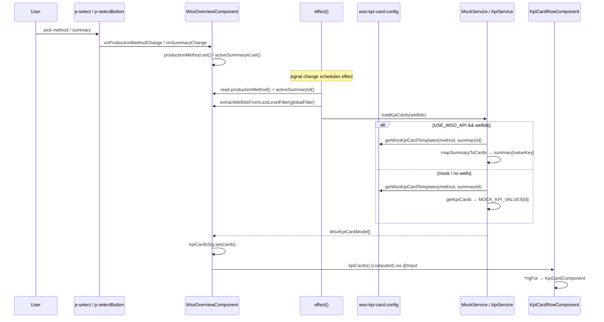

# Case Study — `libs/wso` KPIs by Production Method

Detailed analysis of how the **WSO Overview** feature loads different KPI cards per
**Production Method** (SF Oil / ESP / SF Gas / GL) from a config map instead of
separate pages. A concrete, KPI-only realization of the Visualization-Model +
Registry idea in [ADR-0002](../../architecture-decision/0002-data-driven-chart-layering.md)
and the config-driven patterns in [config-driven-ui-patterns.md](config-driven-ui-patterns.md).

> Source repo: `wpo-app` · Feature: `libs/wso/src/lib/`

## Files involved

| File | Role |
| --- | --- |
| `configs/wso-kpi-card.config.ts` | **Config = source of truth**: method keys, templates, registry, resolvers |
| `services/wso-mock-data.service.ts` | Fills values onto templates (mock) — `getKpiCards(method)` |
| `shared/services/wso-api.service.ts` | Real API — production summaries |
| `components/wso-overview/wso-overview.component.ts` | Orchestrates: `productionMethod` signal + `effect()` |
| `components/kpi/kpi-card-row/kpi-card-row.component.ts` | Dumb row (`@Input cards`) |
| `components/kpi/kpi-card/kpi-card.component.ts` | Dumb single card (`@Input card`) |

## The config (heart of the pattern)

`configs/wso-kpi-card.config.ts`:

- **Method keys**: `WsoProductionMethodKey = 'OILSF' | 'OILESP' | 'GASF' | 'OILGL'`.
- **Template** (presentation metadata only, **no values**):
  `WsoKpiCardTemplate { id; title; unit; showTrendIcon?; showTableIcon? }`.
- **Two template sets**: `OIL_KPI_CARDS` (Oil Rate WSO/WT/Allocation, Potential
  Oil ×2 — `bopd`) and `GAS_KPI_CARDS` (Gas equivalents — `mscfd`).
- **Registry** (method → set):
  ```ts
  WSO_KPI_CARD_CONFIG = {
    OILSF: OIL_KPI_CARDS,  OILESP: OIL_KPI_CARDS,
    GASF:  GAS_KPI_CARDS,  OILGL:  GAS_KPI_CARDS,
  };
  ```
- **Resolvers**: `WSO_PRODUCTION_METHOD_LABEL_MAP` (filter label → key),
  `resolveWsoProductionMethodKey(key|label)`, `getWsoKpiCardTemplates(method)`
  (single entry point), default `OILSF`.

## Data flow

```
productionMethod signal (default OILSF)
   → constructor effect() re-runs on change
   → loadKpiCards(wellIds)
   → getKpiCards(method) | mapSummaryToCards(apiSummary)
   → getWsoKpiCardTemplates(method).map(fill value)
   → kpiCardsSig → kpiCards computed
   → KpiCardRowComponent (@Input cards) → KpiCardComponent
```

- `WsoOverviewComponent.productionMethod` is a `signal<string>` (default
  `WSO_DEFAULT_PRODUCTION_METHOD_KEY`). A `constructor` `effect()` reads it so KPI
  titles update on change.
- Values are filled **after** the template is chosen:
  - Mock: `WsoMockDataService.getKpiCards()` maps templates and injects
    `MOCK_KPI_VALUES` by `template.id`.
  - API: `mapSummaryToCards()` reads `summary[template.valueKey]` (oil/gas-aware)
    and `diffRatio[template.valueKey]` for the delta.
- `KpiCardRowComponent` / `KpiCardComponent` are **dumb** (pure `@Input`/`@Output`),
  no production-method logic.

## Runtime KPI data flow (deep dive)

The KPI row is **reactive**: it is never imperatively refreshed by callers.
Instead, three signals feed one `effect()`, which recomputes the cards. Below is
the end-to-end runtime flow after the 2026-07-24 enhancements.

### Triggers (what causes a KPI refresh)

The `constructor` `effect()` re-runs whenever **any** of these change:

| Trigger | Source | Meaning |
| --- | --- | --- |
| `productionMethod()` | `p-select` → `onProductionMethodChange()` → `.set()` | Well type switched (SF Oil / ESP / SF Gas / GL) |
| `activeSummaryId()` | `p-selectButton` → `onSummaryChange()` → `.set()` | Summary switched (GL: Oil Production ↔ Gas Injection) |
| `globalFilterService.lastLevelFilterSignal()` | Global filter | Selected wells changed |

### Sequence



### Stage-by-stage

1. **Trigger** — a selector calls `.set()` on `productionMethod` /
   `activeSummaryId`, or the global filter signal changes.
2. **effect()** reads all three signals (registering them as dependencies),
   derives `wellIds` via `extractWellIdsFromLastLevelFilter()`, rebuilds
   `baseWellMeta`, then calls `loadKpiCards(wellIds)` (and `loadLosses`).
3. **loadKpiCards** branches:
   - `USE_WSO_API === false` **or** no wells → mock:
     `mockDataService.getKpiCards(method, summaryId)`.
   - else → `apiService.getProductionSummaries(...)`, `catchError → of(null)`,
     then `mapSummaryToCards(summary)` (or mock on null).
4. **Template resolution** (both paths) — `getWsoKpiCardTemplates(method,
   summaryId)` → `KPI_SET_REGISTRY.get(resolveWsoProductionMethodKey(method))`
   → the matching summary's `templates` (or first summary).
5. **Value fill** — `.map()` over templates:
   - Mock: `value = MOCK_KPI_VALUES[template.id]`.
   - API: `value = summary[template.valueKey]`, `deltaPercent =
     diffRatio[template.valueKey]`.
   Produces `WsoKpiCardModel[]`.
6. **Publish** — `kpiCardsSig.set(cards)`; `kpiCards = computed(() =>
   kpiCardsSig())` exposes it.
7. **Render** — template binds `[cards]="kpiCards()"` →
   `KpiCardRowComponent` `*ngFor` → `KpiCardComponent` (dumb; formats value,
   computes `deltaDirection`, emits `tableClick` / `trendClick`).

### Side flows (from a card)

- **Trend dialog** — `KpiCard.trendClick` → `openTrendDialog(card)` →
  `mockDataService.getKpiTrend(card)` → `trendDialogPoints` signal →
  `WsoKpiTrendDialogComponent`.
- **Detail table** — `KpiCard.tableClick` → `openDetailTable()` →
  `detailTableVisible` signal → `WsoDetailTableComponent`.

### Notes / invariants

- **Fully signal-driven**: no manual `refresh()` — changing a signal is the only
  way to update the KPI row.
- **Presentation/data separation**: templates (config) never carry values; values
  are injected only at stage 5.
- **Async safety**: the API subscription is stored in `kpiSubscription` and
  unsubscribed on the next load and in `ngOnDestroy`.
- **Fallback**: any API error silently falls back to mock, so the row always
  renders.

## Mapping to ADR-0002

| ADR layer | `wso` realization |
| --- | --- |
| Metric / KPI | `WsoKpiCardTemplate` (id / title / unit / valueKey) |
| Visualization Model | `WsoKpiSummary` (method → summaries → templates) |
| Registry (no if/else) | `registerKpiSet()` + `KPI_SET_REGISTRY` (Map) + `resolve*()` |
| Data/presentation split | template = metadata; value filled from mock/API |
| Render | `KpiCardRowComponent` / `KpiCardComponent` (dumb) |

## Known gaps / risks

> Status: the four items below were **addressed** on 2026-07-24 — see "Update"
> at the end. Kept here for historical context.

1. **No production-method switcher wired** — `productionMethod` is a signal but
   has no `.set()` call in the overview; it is effectively fixed to `OILSF`. The
   config supports 4 methods, but the UI does not switch between them yet.
2. **GL mapping is questionable** — `OILGL → GAS_KPI_CARDS`, so GL shows **Gas**
   KPIs, while GL primarily produces **oil** and needs a dual Oil-Production +
   Gas-Injection summary (see
   [gl-wells-monitoring.md](../../domain-knowledge/production/gl-wells-monitoring.md)).
   GL's injection KPIs and the summary toggle are not modelled.
3. **ESP lacks equipment-health KPIs** — `OILESP → OIL_KPI_CARDS` (production only);
   Motor Current / PIP / Pump Efficiency (see
   [esp-wells-monitoring.md](../../domain-knowledge/production/esp-wells-monitoring.md))
   are absent.
4. **Positional value mapping is fragile** — both `getKpiCards()` and
   `mapSummaryToCards()` align values to templates by array `index`, and
   `mapSummaryToCards()` always uses `oilRate*` fields (duplicating `oilRateNso`
   for the last two) regardless of gas methods — so Gas methods would show oil
   values. Key values by `template.id` instead.

## Update (2026-07-24) — improvements applied

- **Registry**: static `WSO_KPI_CARD_CONFIG` Record replaced with a
  `registerKpiSet(key, summaries)` registry (`Map`-backed). New well types /
  summaries register themselves; no central branch to edit (OCP).
- **Summaries model**: `WsoKpiSummary { id, label, templates }`; a method can own
  several. `getWsoKpiSummaries(method)` + `getWsoKpiCardTemplates(method, summaryId)`.
- **GL dual summary**: `OILGL` now registers `[Oil Production Summary, Gas
  Injection Summary]` with a new `GAS_INJECTION_KPI_CARDS` set (Injection Gas
  Rate / Pressure / Temperature / Gas Consumption / Gas Lift Efficiency).
- **ESP equipment layer**: `OILESP` now registers `[Oil Production Summary,
  Equipment Health Summary]` with a new `ESP_EQUIPMENT_KPI_CARDS` set (Motor
  Current / Motor Temperature / Pump Intake Pressure / Pump Efficiency / Runtime)
  — closes the Asset-Health KPI-layer gap (item 3).
- **Value keying by id**: `WsoKpiCardTemplate.valueKey` names the API field;
  mock values are a `Record<id, number>`; `mapSummaryToCards()` reads
  `summary[template.valueKey]` (method-aware oil vs gas), removing positional
  coupling.
- **Production-method selector**: `p-select` bound to `productionMethod` via
  `onProductionMethodChange()` → `productionMethod.set()`; a `p-selectButton`
  summary toggle appears only when a method exposes >1 summary (GL). The
  `effect()` now also reacts to `activeSummaryId`.
- Still open: the Equipment (ESP) and Gas-Injection (GL) KPIs are currently
  mock-only — the backend `WsoProductionSummary` has no equipment/injection
  fields yet, so no `valueKey` is set for them.

## Suggested improvements (toward OCP)

- Wire a production-method selector that calls `productionMethod.set(...)` (e.g.
  from the global/map filter), so the config's 4 methods are actually reachable.
- Fill values via `Record<kpiId, value>` matched by `id`; make
  `mapSummaryToCards()` method-aware (oil vs gas fields).
- Model GL Gas-Injection as its own template set + dual-summary toggle.
- Replace the static `WSO_KPI_CARD_CONFIG` Record with a registration function
  (`registerKpiSet(key, templates)`) to add well types without editing existing
  code.

## How to extend — add a new business-layer KPI set

Adding another **business-layer** KPI set (e.g. Wellbore-pressure for Gas,
Reliability, or Economics — see
[business-model/kpi-layers.md](../../business-model/kpi-layers.md)) is a
**config-only** change. The selector, summary toggle, effect, and card components
need **no edits** (OCP).

### Recipe (mock-backed layer)

1. **Define the template set** in `wso-kpi-card.config.ts` — metadata only, ids
   namespaced by layer:
   ```ts
   const GAS_WELLBORE_KPI_CARDS: WsoKpiCardTemplate[] = [
     { id: 'gas-whp', title: 'Wellhead Pressure', unit: 'psi', showTrendIcon: true },
     { id: 'gas-tubing-pressure', title: 'Tubing Pressure', unit: 'psi' },
     { id: 'gas-casing-pressure', title: 'Casing Pressure', unit: 'psi' },
     { id: 'gas-line-pressure', title: 'Line Pressure', unit: 'psi' },
   ];
   ```
2. **Wrap it in a summary** (the summary *is* the business layer):
   ```ts
   const GAS_WELLBORE_SUMMARY: WsoKpiSummary =
     { id: 'wellbore', label: 'Wellbore Pressure Summary', templates: GAS_WELLBORE_KPI_CARDS };
   ```
3. **Register it** — the only line that changes behavior. Append to an existing
   method, or register a new one:
   ```ts
   registerKpiSet('GASF', [GAS_PRODUCTION_SUMMARY, GAS_WELLBORE_SUMMARY]);
   ```
4. **Add mock values by id** in `wso-mock-data.service.ts` `MOCK_KPI_VALUES`:
   ```ts
   'gas-whp': 1850, 'gas-tubing-pressure': 1200, 'gas-casing-pressure': 900, 'gas-line-pressure': 650,
   ```

Done. Because the method now exposes >1 summary, the `p-selectButton` toggle
appears automatically and users can switch to the new layer.

### If the layer is API-backed

5. Add the fields to `WsoProductionSummary` (`wso-api.model.ts`) and set each
   template's `valueKey` to the field name. `mapSummaryToCards()` picks them up
   automatically — no code change there:
   ```ts
   { id: 'gas-whp', title: 'Wellhead Pressure', unit: 'psi', valueKey: 'wellheadPressure' }
   ```

### Adding a whole new production method / well type

1. Add the key to the `WsoProductionMethodKey` union.
2. Add an entry to `WSO_PRODUCTION_METHOD_OPTIONS` (selector) and
   `WSO_PRODUCTION_METHOD_LABEL_MAP` (label → key).
3. `registerKpiSet('<KEY>', [ ...summaries ])` with the layers it needs.
4. Add mock values for any new template ids.

### What you never touch

- `WsoOverviewComponent` (selector/effect/loadKpiCards), `KpiCardRowComponent`,
  `KpiCardComponent` — all layer-agnostic and driven purely by config + signals.

### Conventions

- One **summary = one business layer**; a well type registers the layers it needs
  (Production always; Equipment for ESP; Wellbore/Compression for Gas;
  Gas-Injection for GL).
- Namespace template `id`s by layer (`esp-*`, `gl-*`, `gas-*`) to keep the mock /
  value maps unambiguous.
- Keep templates presentation-only; values arrive from mock (`by id`) or API
  (`by valueKey`).

## Related

- [ADR-0002](../../architecture-decision/0002-data-driven-chart-layering.md) — layering + Builder/Registry rationale.
- [config-driven-ui-patterns.md](config-driven-ui-patterns.md) — the general patterns this applies.
- Production domain knowledge:
  [oil-rate-kpis](../../domain-knowledge/production/oil-rate-kpis.md),
  [esp](../../domain-knowledge/production/esp-wells-monitoring.md),
  [sf-gas](../../domain-knowledge/production/sf-gas-wells-monitoring.md),
  [gl](../../domain-knowledge/production/gl-wells-monitoring.md).
