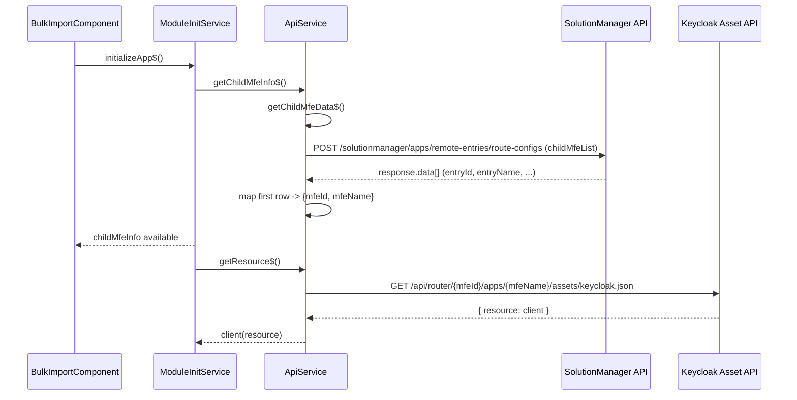

# bulk-import:架构说明(Angular 20 微前端)

**来源:** `EEE-WPO/bulk-import/bulk-import/docs/ARCHITECTURE.zh-CN.md`(2026-11-26 收录;内容以该仓库文档为准,后续版本以仓库为准)
**类型:** 项目架构参考(与 WPO 同属 Module Federation 微前端体系,可对照 [ADR-0001 Module Federation Remote](../architecture-decision/0001-module-federation-remote.md))
**GitLab:** `ds365ai/DFSDEV/base/src/com.hal.dfs.frontend/mfe-apps/bulk-import`

> 以下为原文整理。原文中指向仓库内文件的相对链接(如 `../src/reg_app.json`)在本站不可用,已改为路径文本。Mermaid 图以代码块保留。

## 速览

- Angular 20 + Webpack Module Federation 的 **remote**,生产环境由宿主 `appshost` 在运行时加载。
- 暴露两个 remote 模块:`BulkImportModule`、`DemoModule`;`libs/grid` 为共享 grid 库,不暴露。
- 部署名是 `bulk-import`(`MFE_NAME` / `entryName`),Angular 工程名 `sample-solution` 是模板遗留。
- **待确认:** `childMfeList` 运行时到底应来自 `reg_app.json` 还是 `environment` 的 `MFE_APP_CONFIG`(当前代码用后者,注释写的是前者)。
- **已知问题:** `@nextgengraphics/webviz-3d` 等 `-canary.*` 依赖会因 Artifactory 保留策略 404,导致冷缓存 `npm ci` 失败。

---


## 这是什么

`bulk-import` 是一个基于 Angular 20 的微前端（MFE），采用 Webpack Module
Federation 构建。它在生产环境中不是独立运行，而是作为 remote 在运行时由宿主应用（appshost）加载，注册信息见
`src/reg_app.json`。

`angular.json` 里的 Angular 工程名是 `sample-solution`（模板遗留）；
实际部署/注册名称是 `bulk-import`（对应 `.gitlab-ci.yml` 中的 `MFE_NAME`，以及 `reg_app.json` 中的 `entryName`）。

## 如何被加载

`webpack.config.js` 配置了 `ModuleFederationPlugin`，
将本应用的功能模块暴露为 remotes：

- `BulkImportModule` → `libs/bulk-import/src/lib/bulk-import.module.ts`
- `DemoModule` → `libs/demo/src/lib/demo.module.ts`

并将框架/共享库（`@angular/*`、`@ngrx/*`、`primeng`、
`@webframework/client-core`、`@webframework/client-shared`、
`@ngx-translate/core`、`@angular/material`）标记为与宿主共享的单例，
保证页面内所有联邦 MFE 只加载一份。

运行时，宿主读取 `reg_app.json` 来获取本应用的 `entryPath`（`remoteEntry.js`）
与 `routeMapList`（不同 API 路径应走哪个后端 service router）。
`mfe-init.ts` 会读取宿主注入到 NgRx store
（`state.activePage`）的 active-page 配置，用它解析当前 MFE 的资源/配置路径，
并基于 `routeMapList` 组装后端 URL。

`app-routing.module.ts` 也展示了反向能力：该应用可通过 `loadRemoteModule`
直接加载*其他*联邦 remote（见 `tdemo` 路由），不依赖宿主转发。

## Child MFE 信息获取链路（bulk-import）

本节说明 **bulk-import** 如何解析 child MFE 信息（`mfeId`/`mfeName`），以及后续如何消费。

### 端到端链路

1. `BulkImportComponent` 在构造函数里启动模块初始化：  
   `this.moduleInitService.initializeApp$()`  
   （`libs/bulk-import/src/lib/components/bulk-import/bulk-import.component.ts`）
2. `ModuleInitService.initializeApp$()` 首先调用
   `ApiService.getChildMfeInfo$()`  
   （`src/app/services/module-init.service.ts`）
3. `ApiService.getChildMfeInfo$()` 调用 `getChildMfeData$()`，并把返回数组第一项映射为：
   - `mfeId = firstEntry.entryId`
   - `mfeName = firstEntry.entryName`  
   （`src/app/services/api.service.ts`）
4. `ApiService.getChildMfeData$()` 将 `childMfeList` POST 到：  
   `solutionmanager/apps/remote-entries/route-configs`  
   （`src/app/services/api.service.ts`）
5. 期望响应是数组结构的 route config 数据，当前会使用第一行作为本次会话的 child MFE 真值来源。
6. 后续 `ApiService.getResource$()` 使用该 `mfeId/mfeName` 组装：  
   `api/router/{mfeId}/apps/{mfeName}/assets/keycloak.json`  
   （`src/app/services/api.service.ts`）

### 流程图

```mermaid
flowchart TD
  A[BulkImportComponent.initApp] --> B[ModuleInitService.initializeApp$]
  B --> C[ApiService.getChildMfeInfo$]
  C --> D[ApiService.getChildMfeData$]
  D --> E[POST solutionmanager/apps/remote-entries/route-configs<br/>body = childMfeList]
  E --> F[response.data or response array]
  F --> G[first entry]
  G --> H[mfeId = entryId<br/>mfeName = entryName]
  H --> I[ApiService.getResource$]
  I --> J[GET api/router/{mfeId}/apps/{mfeName}/assets/keycloak.json]
  J --> K[client(resource) for downstream config loading]
```

### 时序图



### 数据来源细节

- 当前 `ApiService` 实现是从 `src/environments/environment.prod` 导入 `MFE_APP_CONFIG`，
  并使用 `MFE_APP_CONFIG.childMfeList` 作为 POST body 初始值。
- `src/reg_app.json` 中也有 `childMfeList`，但 `getChildMfeData$()` 运行时代码并未直接读取 `reg_app.json`。

### 待确认问题（需与平台/运行时负责人确认）

- 运行时 `childMfeList` 预期应来自 `reg_app.json`，还是有意来自 environment 文件中的 `MFE_APP_CONFIG`？
  - 当前代码路径使用 `MFE_APP_CONFIG`。
  - `ApiService` 方法注释仍写的是读取 `reg_app.json`。

## 数据流（NgRx）

标准 NgRx 单向数据流，按 feature 拆分：

```
component → action (src/app/actions) → effect (src/app/effects, side effects/HTTP)
                                       → reducer (src/app/reducers) → store
component ← selector (src/app/reducers) ← store
```

当前根级 slices：`breadcrumb`、`loader`、`userPrivilege`、`alert`（messages）、
`serviceconfig`、`clientName`，以及路由状态（`@ngrx/router-store`）。
`src/app/reducers/index.ts` 负责组合为 `AppState` 并定义 selectors。
并非每个 slice 都有 effect——当前只有 `breadcrumb` 和 `serviceconfig` 有；
其余由 reducer 直接更新。

`libs/bulk-import/src/lib/components/store` 维护 bulk-import feature 自己的 NgRx slice，
与上述 shell 根状态分离。

## 目录结构

```
bulk-import/
├── src/app/              壳应用：路由、根 NgRx 状态、MFE 启动逻辑
│   ├── actions/          每个 NgRx feature slice 的 action
│   ├── effects/          副作用处理（部分 slice）
│   ├── reducers/         reducers + AppState 组合 + selectors
│   ├── services/         Angular 服务（HTTP、业务逻辑）
│   ├── models/           TS 接口/类型
│   ├── directives/       自定义指令
│   ├── pipes/            自定义管道
│   └── mfe-init.ts       从宿主解析本 MFE 配置/资源路径
├── src/reg_app.json      MFE 注册信息（构建时复制到 dist/assets/）
├── src/environments/     environment.ts / environment.prod.ts
├── libs/
│   ├── bulk-import/      bulk-import 主功能模块（对外暴露 remote）
│   ├── demo/             demo 功能模块（对外暴露 remote）
│   └── grid/             共享 grid 组件库（不作为 remote 暴露）
├── configs/              部署期配置、打包和安装后脚本
├── CICD/                 被 .gitlab-ci.yml 调用的脚本（构建/部署/扫描）
├── tools/                i18n、schematics 及其他开发工具
└── docs/                 本文档（adr/ 规划中，当前尚未落地）
```

## 外部依赖

- **`@dfs/toolkit-config-data`、`@dfs/dfs-core`**：DFS 平台配置访问能力
  （例如 `DSISConfigDataService`，在 `mfe-init.ts` 中使用）和核心工具。
- **`@webframework/client-core`、`client-layout`、`client-shared`、`client-theme`**：
  appshost 自有框架（认证/会话服务、布局壳、共享 UI、主题），跨 MFE 共享单例。
- **`@nextgengraphics/webviz-3d`、`webviz-map`、`webviz-common*`**：
  可视化组件（3D viewer、地图）。
- **Angular Material + PrimeNG**：当前同时使用两套组件库；
  新增 UI 前优先复用周边已有组件，不建议再引入第三套。
- **`@angular-architects/module-federation`**：Module Federation 工具链
  （`loadRemoteModule`、webpack 插件接线）。

## 构建与部署

`.gitlab-ci.yml` 的大多数流水线来自共享的
`template_pipeline/solution-component-frontend/*` CI/CD 组件
（build、deploy、config、xray、staging、on-prem），而不是在本仓库内逐条定义；
排查流水线时应先看共享模板。

`CICD/build.sh` 是本仓库直接维护的构建脚本：执行
`npm install --force && npm run build`，打包 `dist/` 与 `configs/`，
再上传到 DFS apps 制品仓库。

## 已知问题

`@nextgengraphics/webviz-3d`（以及可能的其他 `-canary.*` 固定版本依赖）会因
snapshot/canary 保留策略在 Artifactory 上出现 404。这会导致冷缓存情况下
`npm ci`/`npm install` 失败，且与具体代码变更无关。

在处理 [!25](https://gitlab.com/ds365ai/DFSDEV/base/src/com.hal.dfs.frontend/mfe-apps/bulk-import/-/merge_requests/25)
单测任务时，也出现过相关 Artifactory 镜像解析问题（例如 `pkijs` 版本不可解析、
runner 触发 lockfile 重建）；若干净安装失败，建议优先参考该 MR 的处理记录。
